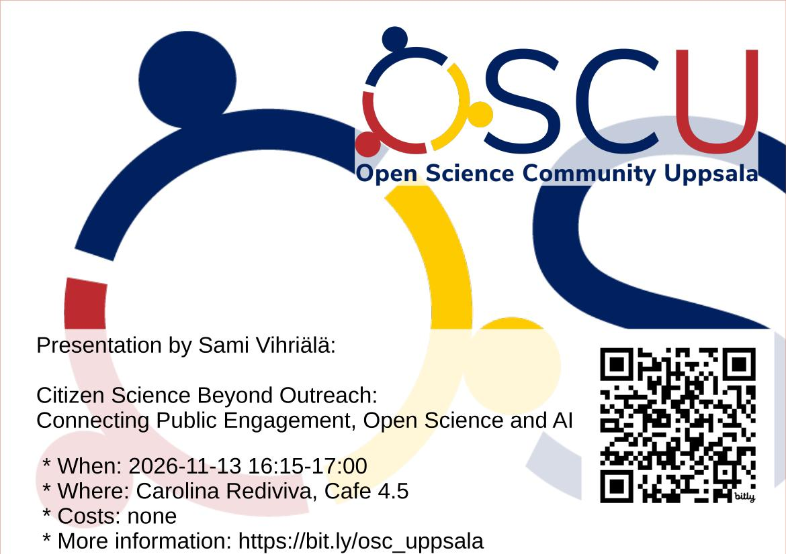

# 2026-11-13 Sami Vihriälä: 'Citizen Science Beyond Outreach: Connecting Public Engagement, Open Science and AI'

- Who: Sami Vihriälä
- Title: Citizen Science Beyond Outreach: Connecting Public Engagement, Open Science and AI
- When: 2026-11-13 16:15-17:00
- Where: [Carolina Rediviva](https://link.mazemap.com/90ZtnxI3), Cafe 4.5
  ([detailed route](https://open-science-community-uppsala.github.io/open_science_community_uppsala/where/))

## Talk description

Citizen Science in Practice: Lessons Learned, Future Opportunities,
and the Role of Open Science and AI
 
Citizen science has the potential to create value for researchers,
participants, and society alike. During the past decade,
Sami Vihriälä has managed and supported a range of citizen science
initiatives at the Faculty of Science and Technology at Uppsala University,
engaging schools and the wider public in authentic research projects.
Most of these projects have followed a relatively traditional
citizen science model, where participants contribute to scientific
research through large-scale data collection.
This approach has proven highly successful, generating valuable research data
while creating meaningful opportunities for public engagement with science.
 
In this presentation, Sami will share practical experiences and lessons learned
from several completed projects. He will discuss what has worked well,
the challenges encountered, and the factors that contribute to successful
collaborations between researchers and citizen scientists.
The talk will also look ahead. As Open Science practices and AI tools
increasingly shape the research landscape, new opportunities are emerging
for citizen science. How can citizen science be integrated earlier in
research planning and funding applications? How might public participation
contribute to more open, transparent, and impactful research?
And what role could AI play in supporting future citizen science initiatives?
 
The presentation will conclude with an open discussion on how universities
can strengthen the connections between citizen science, Open Science, and AI,
and how these approaches may help shape the future of research
and public engagement.
